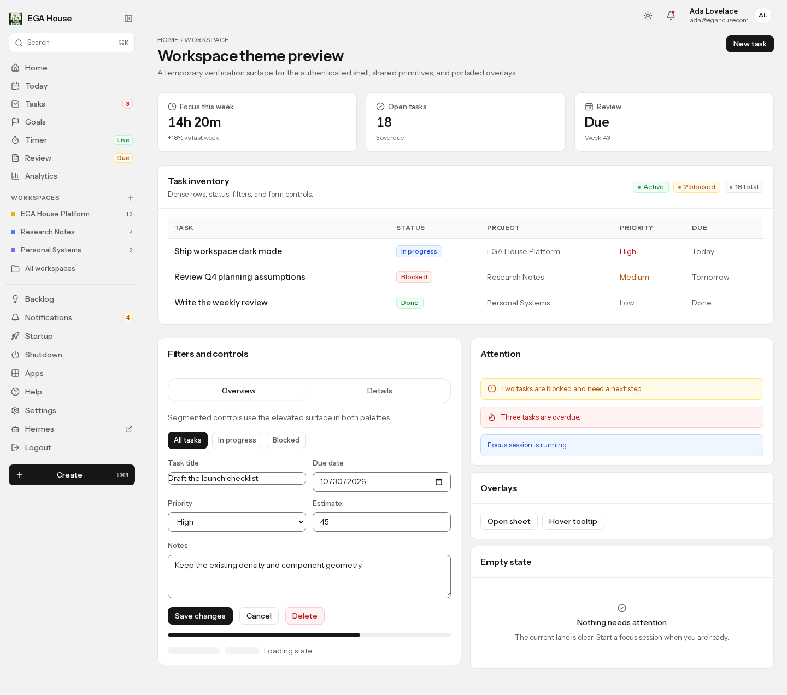
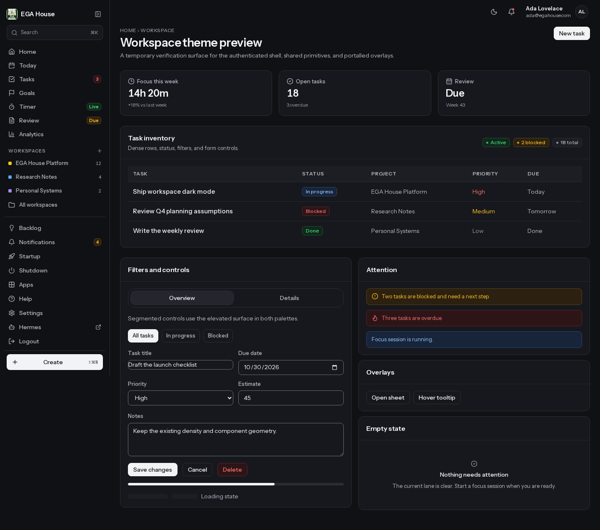

# Web Workspace Dark Mode V1 — Audit and Evidence

- **Base:** `5fe662388211aeab9046416e9711eabdf7ad4c7b` (`origin/main`, after security PR #299)
- **Branch:** `feat/web-dark-mode`
- **Final head:** recorded in the PR metadata after the final commit.
- **Scope:** authenticated web workspace in `apps/web`; no mobile, backend,
  database, auth-contract, or public marketing/auth redesign.
- **Status:** implementation, local verification, and authenticated route-level
  browser QA are complete; independent review and final exact-head CI remain
  external gates.

## 1. Verified baseline findings

| Area | Existing implementation | Gap | Required change | Risk | Test |
|---|---|---|---|---|---|
| Theme mechanism | No preference controller; `data-workspace-theme="workspace"` was a marker without styling consumers | No Light/Dark/System state, persistence, OS listener, or pre-paint application | Add a dependency-free controller, inline init script, and scoped dark selector | Medium: hydration/flash regressions | Store/control tests; live browser hydration check |
| Token authority | Light-only values in `styles/tokens.css`; semantic names already cover surfaces, status, priority, data, focus, overlays, shadows | No dark declarations | Add one scoped dark block on `<html>`; no second design system | High if scoped incorrectly: public pages could inherit dark tokens | Token tests; public isolation test; Playwright fixture |
| Shell marker | `WorkspaceShell` and `WorkspaceSkeletonShell` set the marker; all authenticated pages route through them | Marker did not theme anything | Use the marker as the `:has()` isolation boundary | Medium | Shell source test; visual fixture |
| Portal overlays | Sheet, tooltip, Radix dialogs portal to `document.body` | A container-scoped theme would not reach portals | Put dark tokens on `<html>` only while the workspace marker exists | Medium | Browser sheet/tooltip verification |
| Tabs | `bg-white`, `hover:bg-white/70`, literal shadow | Light-only elevated control | Use `--ega-surface-elevated`, `--ega-surface-hover`, `--ega-shadow-sm` | Low | Source scan; visual fixture |
| Tooltip | `bg-[var(--ega-sidebar)] text-white` | Already unreadable in light mode (`#f2f2f2` + white); also wrong in dark | Inverted ink surface with `--ega-on-ink` | Medium: fixes a pre-existing defect | Browser tooltip readback |
| OAuth consent | Ink hero used `text-white`; black-alpha panels | Explicit dark makes ink light, so white text would fail | `--ega-on-ink*` tokens and surface tokens | Medium (authenticated surface) | Source scan; token contrast |
| Notifications/menus | Token-driven | No gap found | None | Low | Source scan |
| Health coach | Cards forced `bg-white`; `text-amber-700` | White cards in dark; fixed amber fails on dark | Card surface + `--status-risk` | Low | Source scan |
| Timer outcome | Radio labels forced `bg-white` | White cards in dark | `--ega-surface` | Low | Source scan |
| Dialog chrome | Overlays/shadows hardcoded `rgba(17,17,15,…)` / `rgba(22,31,44,…)` | Light-specific overlay/shadow | `--ega-overlay`, `--ega-shadow-lg`, `--ega-shadow-footer` | Low | Source scan; sheet screenshot |
| Undefined tokens | `--surface-primary` / `--surface-secondary` in Today intelligence | Transparent panel/hover in every mode | Replace with `--ega-surface` / `--ega-surface-hover` | Low (pre-existing) | Source scan |
| Home illustration | Literal `#fde68a` sun | Hardcoded light decoration | `color-mix()` from data-yellow and surface | Low | Source scan |
| Form boundaries | Light control border `#e5e5e5` (~1.2:1) | Fails 3:1 non-text contrast in both modes | Add `--ega-control-border` (light `#767676`, dark `#6b7280`) | Low: visible light delta | Contrast test; browser readback 3.67:1 dark |
| Native controls | No `color-scheme` for the workspace | Date/select/scrollbar UI stayed light in dark | Set `color-scheme` only while the workspace marker exists | Low | Browser computed `color-scheme: dark` |
| Initial paint | No theme script | Dark preference would flash light | Inline pre-paint script; deterministic server snapshot | Medium | `domcontentloaded` readback; no console warnings |
| Public marketing | `home.css` owns `--home-*` and `prefers-color-scheme` | Must not be overridden | Token selector requires the workspace marker; no public CSS edits | High if leaked | Computed public background/scheme checks |
| Public auth | `auth.css` owns `--auth-*` and `prefers-color-scheme` | Must not be overridden | Same `:has()` boundary; no auth CSS edits | High if leaked | Public login screenshot/readback |
| PWA manifest | Static `background_color` / `theme_color` | Splash colors cannot follow a user preference | Unchanged; documented limitation | Low | Manifest inspection |
| Error/loading | Skeleton/error surfaces use shell markers except standalone fallbacks | Standalone fallbacks lacked a marker | Add marker to error fallbacks, home error, OAuth consent, global-error script | Low | Source review |
| Charts | Token + `color-mix` grammar | No hardcoded chart colors after the sun fix | Dark data/soft tokens | Low | Source scan; review |
| Tests | Light token test; contrast test read the first declaration by name | Dark values would be silently untested | Parse light and dark blocks separately; add dark contract | Medium | `tokens-contrast.test.ts` (11 tests) |

### Classification

**Verified by source, tests, or browser:** all rows above. The tooltip light
contrast defect, undefined Today tokens, hardcoded white surfaces, and
non-text control-border contrast are pre-existing defects exposed by the dark
mode audit.

**Suspected / not independently verified:** individual authenticated routes were
not driven with a real session (no credentials available). Their source uses the
shared shell, primitives, and token names that were exercised in the harness.
Any route-local visual defect outside those primitives remains unverified.

**Unverified manual matrix:** WebKit/Firefox, real PWA standalone splash,
assistive-technology screen-reader passes, and cross-device OS theme changes.

## 2. Theme architecture

- `styles/tokens.css` remains the only color authority. Light values stay in
  `:root`. Dark values live in
  `html[data-theme="dark"]:has([data-workspace-theme="workspace"])`.
- The selector sits on `<html>` so portal content inherits the same values.
  `:has()` prevents dark tokens from resolving on public pages, which do not
  render the authenticated marker.
- `src/lib/theme-preference.ts` owns supported values, parsing, resolution, and
  the pre-paint script string.
- `src/lib/workspace-theme-store.ts` owns the browser store: safe storage access,
  matchMedia subscription, localStorage-scoped storage-event cross-tab sync,
  document painting, and subscription notification.
- `src/lib/hooks/workspace-theme.ts` binds the store to
  `useSyncExternalStore`; the server snapshot is always `system`.
- `WorkspaceThemeController` is mounted once in the root layout. The top-bar
  `ThemeControl` uses a native disclosure with Light/Dark/System labels,
  `aria-pressed`, Escape/outside-click close, and focus return.
- No dependency was added. No server request, cookie, database read, or account
  setting is involved. Preference is per browser via
  `localStorage["ega-workspace-theme"]`.

## 3. Behavior

| Case | Observed |
|---|---|
| No stored preference | System; follows `prefers-color-scheme` |
| Explicit Light on OS dark | Light |
| Explicit Dark on OS light | Dark |
| OS change in System mode | Live update without refresh |
| Invalid stored value | System |
| Storage get/set throws | System/in-memory switch still works |
| Reload | Stored preference reapplied before paint |
| Client navigation / shell remount | Selected preference and control state persist |
| Cross-tab update | `storage` event for the workspace `localStorage` updates; sessionStorage/other areas are ignored |
| Portal dialog/tooltip | Inherits dark tokens |
| Public login with workspace Dark | Auth stays on its own OS-driven palette |
| Public homepage with workspace Light and OS dark | Homepage stays OS dark |
| Hydration | Server snapshot `system`; no console hydration warnings observed |

## 4. Surfaces changed

- Tokens/global: `apps/web/src/styles/tokens.css`,
  `apps/web/src/app/globals.css`
- Theme runtime: `apps/web/src/lib/theme-preference.ts`,
  `apps/web/src/lib/workspace-theme-store.ts`,
  `apps/web/src/lib/hooks/workspace-theme.ts`,
  `apps/web/src/components/layout/theme-control.tsx`
- Shell: `apps/web/src/app/layout.tsx`, `apps/web/src/app/global-error.tsx`,
  `apps/web/src/components/layout/top-bar.tsx`,
  `apps/web/src/components/layout/workspace-error-fallback.tsx`,
  `apps/web/src/app/home/error.tsx`, `apps/web/src/app/oauth/consent/page.tsx`
- Shared styling: `apps/web/src/styles/workspace.css`,
  `apps/web/src/components/ui/tabs.tsx`,
  `apps/web/src/components/ui/tooltip.tsx`,
  `apps/web/src/components/layout/shortcut-help-sheet.tsx`,
  `apps/web/src/components/layout/sidebar-create-button.tsx`
- Hardcoded light fixes: health snapshot, timer stop prompt, Today intelligence,
  the five modal/overlay call sites, Home illustration
- Authenticated QA fix: shared `Textarea` now fills its form column
- Docs/tests: design-system doc, token tests, store/control tests,
  Playwright dark contract

All authenticated route pages already compose `AppShell` /
`TasksWorkspaceShell` / redirects; no route behavior, query parameter, or
navigation path changed.

## 5. Validation evidence

Executed from the final worktree:

```text
npm run web:typecheck          PASS
npm run web:test               PASS — 242 files, 1817 tests
npm run web:build              PASS — with local dummy Supabase env (no secrets)
npm run check:architecture     PASS
npm run test:architecture      PASS — 21 tests
npm run ci:purity              PASS
npm run web:test:visual        PASS — 9 passed, 1 skipped (command palette
                               skipped on /login because the authenticated
                               trigger is absent)
```

`npm --workspace @ega/web run lint` is **not green on the base** either. It
reports 8 errors and 20 warnings in untouched files (agent task handler tests,
`operator-acceptance.test.ts`, `review/export/route.test.ts`, Today progressive
disclosure tests, `startup-planner-service.test.ts`). The same command on
`origin/main` reports the same 8 errors and 20 warnings. `eslint` over every
file changed by this branch reports no findings.

### Authenticated route QA (local seeded account)

A dedicated isolated local Supabase stack was started and seeded with one test
owner, project, goal, tasks, sessions, notifications, review, and inbox items.
The production build was then driven with a real session in Chromium:

- 18 authenticated routes checked at 1440px in dark mode; representative routes
  also checked in light mode.
- 9 authenticated routes checked at 390px touch viewport in dark and light.
- Command palette, task edit dialog, and mobile drawer checked as portalled /
  overlay surfaces.
- Zero white/near-white surfaces in the authenticated workspace in dark mode.
- No document horizontal overflow. Mobile Analytics reported a 9px
  `documentElement` delta from the vertical scrollbar; `body.scrollWidth` equals
  its client width and the wide table/heatmap scroll in their own containers.
- No uncaught page errors and no theme-related console errors.
- Theme control Light → Dark → reload persisted; System followed OS media
  changes live.
- Review textarea width defect found and fixed in the shared primitive.

Details and screenshots:
[`authenticated/README.md`](./authenticated/README.md).

### Harness checks

Browser checks used Chromium against a production build. The workspace harness
mounted the real `WorkspaceShell`, shared UI primitives, theme control, custom
sheet, and tooltip. Results:

- Dark shell `rgb(16, 17, 20)`, panel `rgb(23, 24, 29)`, zero white surfaces in
  the workspace subtree.
- Page-title contrast 17.00:1; secondary copy 9.50:1; table header 8.38:1;
  input boundary 3.67:1.
- `color-scheme: dark` on the workspace and native inputs.
- No document overflow at 320, 390, 900, or 1440 px.
- Theme menu options present; Light selection persisted and applied immediately.
- Sheet and tooltip portals used the dark palette.
- `domcontentloaded` already had `data-theme="dark"`; no hydration warnings.
- System mode changed dark→light after a live media-emulation change.
- Public login stayed on its cream palette with a workspace Dark preference;
  public homepage stayed OS-dark with a workspace Light preference.

### Screenshots

Authenticated route evidence (local seeded Supabase) is in
[`authenticated/`](./authenticated/README.md):

- [Desktop Home dark](./authenticated/desktop-home-dark.png) ·
  [Light](./authenticated/desktop-home-light.png)
- [Desktop Today dark](./authenticated/desktop-today-dark.png)
- [Desktop Tasks dark](./authenticated/desktop-tasks-dark.png)
- [Desktop Review dark](./authenticated/desktop-review-dark.png)
- [Desktop command palette dark](./authenticated/desktop-command-palette-dark.png)
- [Desktop task edit dialog dark](./authenticated/desktop-edit-dialog-dark.png)
- [Mobile Home dark](./authenticated/mobile-home-dark.png)
- [Mobile Today dark](./authenticated/mobile-today-dark.png)
- [Mobile Tasks dark](./authenticated/mobile-tasks-dark.png)
- [Mobile Analytics dark](./authenticated/mobile-analytics-dark.png)
- [Mobile drawer dark](./authenticated/mobile-drawer-dark.png)

The remaining screenshots are from the temporary visual harness (real
shell/primitives, synthetic content). The harness route was removed before the
final diff. They supplement the authenticated route evidence above.

| Light | Dark |
|---|---|
|  |  |

- [Theme menu](./desktop-dark-theme-menu.png)
- [Portalled sheet](./desktop-dark-sheet.png)
- [Tooltip](./desktop-dark-tooltip.png)
- [Mobile 390 dark](./mobile-390-dark.png)
- [Public login with workspace Dark preference](./public-login-workspace-dark-pref.png)

## 6. Known limitations and manual QA

1. **Authenticated QA is local-only.** It used an isolated local Supabase stack
   and seeded account. Production/staging authentication, real user data, and
   environment-specific integrations were not exercised. The committed
   Playwright suite still accepts a `/login` redirect for protected routes.
2. **PWA standalone splash is static.** `public/manifest.webmanifest` keeps
   `background_color: #f6f7f2` and `theme_color: #177b52`. The in-app workspace
   uses `color-scheme: dark`; manifest splash colors cannot vary per user
   preference. A future branded dark splash needs a separate manifest strategy.
3. **Browser matrix.** Chromium only. `:has()` is required for the scoping rule;
   unsupported browsers receive the light workspace rather than a broken dark
   surface.
4. **Cross-device sync.** Preference is localStorage-only (per browser profile),
   deliberately avoiding a server request or account-setting subsystem.
5. **Light control border.** `--ega-control-border` is darker than the previous
   structural border to meet 3:1. This is a deliberate accessibility correction.
6. **Remaining manual QA:** production/staging authenticated pass, OS theme
   change while a modal is open, browser zoom/text scaling, and PWA standalone
   on iOS/Android.

## 7. Verdict

Implementation, local verification, and authenticated route QA are complete.
The PR is open and **not merged or deployed**. Merge remains blocked on
independent review and green exact-head CI, not on a known implementation
failure.
