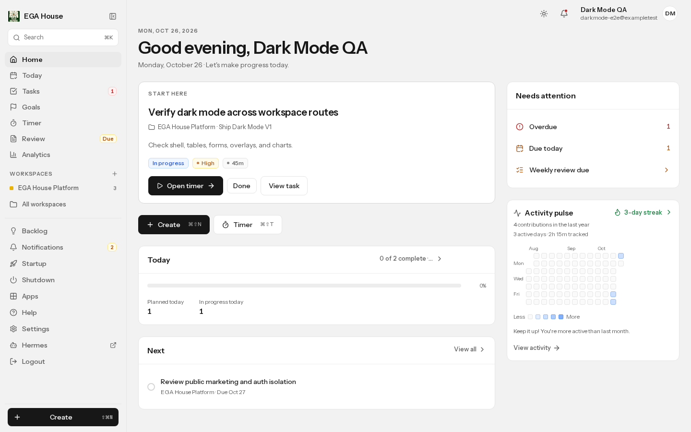
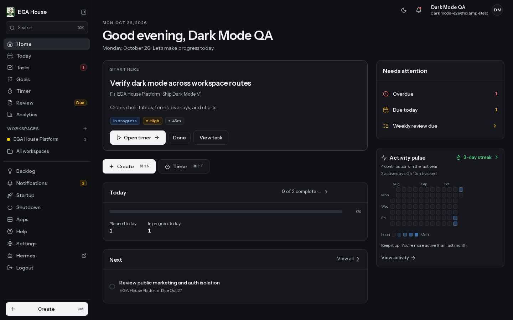

# Authenticated dark-mode QA — 2026-10-26

This evidence was captured against an **isolated local Supabase stack** (Postgres,
GoTrue, PostgREST, Kong) with a dedicated seeded test account, not production.
No production credentials or data were used.

## Environment

- Next.js production build of `feat/web-dark-mode` at `f0b0a0f0`
  (security remediation from `main` merged in).
- Supabase local API `http://127.0.0.1:54321`, Postgres `127.0.0.1:54322`.
- Local migrations: `0000`–`0034` and `0037`–`0063`. The automation-only
  migrations `0035`/`0036` and the production-owner reconciliation `0043` were
  not applicable to a fresh local database:
  - `0035`/`0036` assume the production `automation.implementation_runs` table,
    which is provisioned outside this repository.
  - `0043` asserts a specific production account email and is a data repair, not
    a schema requirement.
- Seeded owner: one test user, one project, one goal, four tasks (in-progress,
  todo, done, blocked), three completed sessions, two unread notifications, one
  saved review, two inbox ideas, UTC time context.

## Coverage

Desktop: 1440×900. Mobile: 390×844 (touch). Both Light and Dark were captured
for the representative routes below; dark was checked across the full set.

| Route | Desktop dark | Mobile dark | Notes |
|---|---|---|---|
| `/home` | ✅ | ✅ | Home dashboard, activity pulse |
| `/today` | ✅ | ✅ | Lanes, task cards, right rail |
| `/tasks` | ✅ | ✅ | List/board controls, rows, actions |
| `/tasks/projects` | ✅ | — | Project index |
| `/tasks/projects/[slug]` | ✅ | — | Project detail |
| `/goals` | ✅ | ✅ | Goal cards/forms |
| `/timer` | ✅ | ✅ | Start form, sessions table |
| `/review` | ✅ | ✅ | Review form, charts, insights |
| `/work-analytics` | ✅ | ✅ | KPIs, SVG charts, heatmap |
| `/notifications` | ✅ | ✅ | Inbox rows and actions |
| `/backlog` | ✅ | — | Backlog items and forms |
| `/ideas` | ✅ | — | Existing redirect to `/backlog` |
| `/startup` | ✅ | — | Startup ritual |
| `/shutdown` | ✅ | — | Shutdown ritual |
| `/settings/account` | ✅ | ✅ | Settings forms and native controls |
| `/help` | ✅ | — | Help directory/search |
| `/apps` | ✅ | — | Apps launcher |
| `/friction` | ✅ | — | Friction radar |

Portal overlays: command palette, task edit dialog, mobile navigation drawer.

## Results

- **Zero white/near-white surfaces** in the authenticated workspace subtree in
  dark mode on every checked route.
- `color-scheme: dark` applied to the workspace and native form controls.
- **No document horizontal overflow.** The mobile analytics page reports a 9px
  `documentElement` delta caused by the vertical scrollbar; `body.scrollWidth`
  equals `body.clientWidth` and the table/heatmap scroll inside their own
  containers. Desktop and all other mobile routes report zero.
- No uncaught page errors and no theme-related console errors. Local realtime
  WebSocket 503 messages are expected because realtime was not needed for this
  pass.
- Theme control: Light → Dark → reload persisted; System followed
  `prefers-color-scheme` live in both directions.
- Task edit dialog background `rgb(23, 24, 29)`, text `rgb(242, 243, 245)`.
- Mobile drawer background `rgb(16, 17, 20)`, text `rgb(242, 243, 245)`,
  `color-scheme: dark`.
- Command palette and sheet/dialog content inherited the dark tokens.

## Defect found and fixed

Authenticated Review QA exposed that the shared `Textarea` primitive had no
`w-full`, so fields rendered at their intrinsic ~20-column width. That is a
pre-existing shared-form defect, visible in both palettes. Fixed in
`apps/web/src/components/ui/textarea.tsx` with explicit call-site widths still
able to override it. Review screenshots below were captured after the fix.

## Screenshots

| Light | Dark |
|---|---|
|  |  |

- [Desktop Today dark](./desktop-today-dark.png)
- [Desktop Tasks dark](./desktop-tasks-dark.png)
- [Desktop Timer dark](./desktop-timer-dark.png)
- [Desktop Analytics dark](./desktop-analytics-dark.png)
- [Desktop Review dark](./desktop-review-dark.png) · [Light](./desktop-review-light.png)
- [Desktop Settings dark](./desktop-settings-dark.png)
- [Command palette dark](./desktop-command-palette-dark.png)
- [Task edit dialog dark](./desktop-edit-dialog-dark.png)
- [Mobile home dark](./mobile-home-dark.png) · [Light](./mobile-home-light.png)
- [Mobile Today dark](./mobile-today-dark.png)
- [Mobile Tasks dark](./mobile-tasks-dark.png)
- [Mobile Review dark](./mobile-review-dark.png)
- [Mobile Analytics dark](./mobile-analytics-dark.png)
- [Mobile navigation drawer dark](./mobile-drawer-dark.png)
